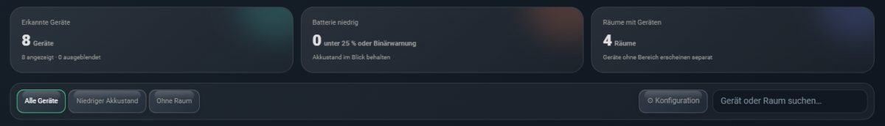
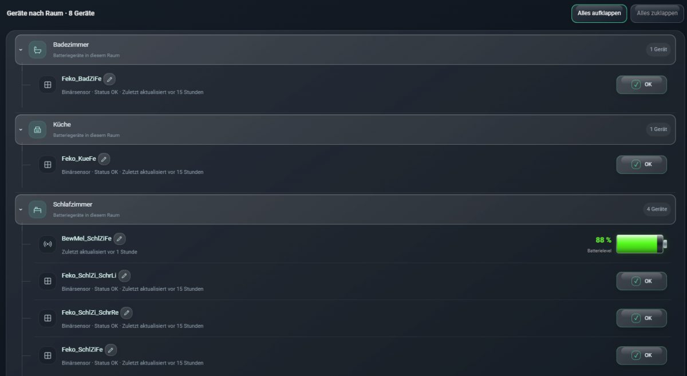
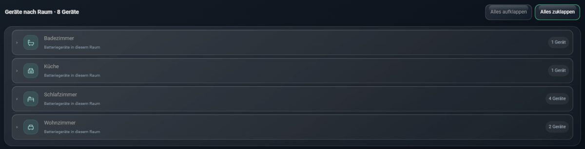

# Modern-Batterie-Monitor

**Version 1.8.0**

Modern-Batterie-Monitor ist eine responsive Lovelace-Karte für batteriebetriebene Smart-Home-Geräte. Das erste Release erkennt Batterie-Prozentwerte und Binärsensoren, ordnet Geräte ihren Räumen zu und zeigt Warnungen übersichtlich im Dashboard.

## Screenshots

**Übersicht und Filter**

**Räume und Geräte aufgeklappt**

**Räume eingeklappt**

## Funktionen

- Erkennt Batterie-Prozentwerte und Binärsensoren mit `device_class: battery`.
- Gruppiert Smart-Home-Geräte nach Home-Assistant-Bereichen; Geräte ohne Bereich stehen am Ende.
- Zeigt Prozentwerte und niedrige Ladestände. Binärsensoren erscheinen mit ihrem Status, ohne einen Prozentwert vorzutäuschen.
- Bietet Suche, Filter, einstellbare Warnschwelle, anpassbare Anzeigenamen und das Ausblenden einzelner Geräte.
- Filtert Mobiltelefone, Tablets und Wearables standardmäßig aus; die Option lässt sich ändern.
- Verwendet die in Home Assistant eingestellte Sprache.
- Kann Benachrichtigungen bei niedrigem Ladestand senden.
- Schätzt den letzten Batterietausch aus der aufgezeichneten Sensorhistorie, sofern ein plausibler Wechsel erkannt wird.

## Installation mit HACS

1. In HACS **Benutzerdefinierte Repositories** öffnen.
2. `https://github.com/Letasil/Modern-Batterie-Monitor` als Kategorie **Dashboard** hinzufügen.
3. **Modern-Batterie-Monitor** installieren und Home Assistant sowie den Browser neu laden.
4. Eine manuelle Karte hinzufügen und die Konfiguration aus [`lovelace-example.yaml`](lovelace-example.yaml) verwenden.

Die Release-Datei `modern-batterie-monitor.js` wird zusätzlich einzeln angehängt. Sie enthält die Übersetzungen eingebettet und funktioniert daher auch dann, wenn HACS nur diese eine Datei herunterlädt. Das ZIP im Release ist für die manuelle Installation und enthält die JavaScript-Datei direkt im ZIP-Hauptverzeichnis.

Falls HACS die Ressource nicht automatisch registriert, unter **Einstellungen → Dashboards → Ressourcen** die JavaScript-Datei als **JavaScript-Modul** eintragen.

## Manuelle Installation

1. `modern-batterie-monitor.js` nach `www/` im Home-Assistant-Konfigurationsverzeichnis kopieren. Die Dateien in `translations/` können zusätzlich mitkopiert werden; die Karte enthält die Übersetzungen bereits eingebettet.
2. `/local/modern-batterie-monitor.js` unter **Einstellungen → Dashboards → Ressourcen** als **JavaScript-Modul** registrieren.
3. Die Beispielkarte aus [`lovelace-example.yaml`](lovelace-example.yaml) in ein Dashboard einfügen.

## Kartenoptionen

| Option | Standard | Bedeutung |
| --- | --- | --- |
| `title` | `Batterien` | Überschrift der Karte |
| `low_threshold` | `25` | Warnschwelle für Prozent-Sensoren |
| `hidden_entities` | `[]` | Geräte oder Entitäten, die ausgeblendet werden |
| `name_overrides` | `{}` | Eigene Anzeigenamen |
| `notifications_enabled` | `false` | Benachrichtigungen aktivieren |
| `notification_service` | `""` | Home-Assistant-Dienst, zum Beispiel `notify.mobile_app_handy` |
| `show_mobile_devices` | `false` | Mobilgeräte und Wearables ebenfalls anzeigen |

## Hinweise

Neue Batterie-Sensoren werden beim Laden der Karte und bei einer Home-Assistant-Aktualisierung mit neuen Batterie-Entitäten gesucht. Für Raum- und Gerätenamen nutzt die Karte die Home-Assistant-Registrierungen.

Das Batterietauschdatum ist eine Schätzung. Es wird nur angezeigt, wenn der Recorder eine plausible Zustandsänderung gespeichert hat. Benachrichtigungen aus der Karte werden gesendet, solange ein Home-Assistant-Dashboard mit der Karte geöffnet ist; für Hintergrundbenachrichtigungen eignet sich eine Home-Assistant-Automation.
